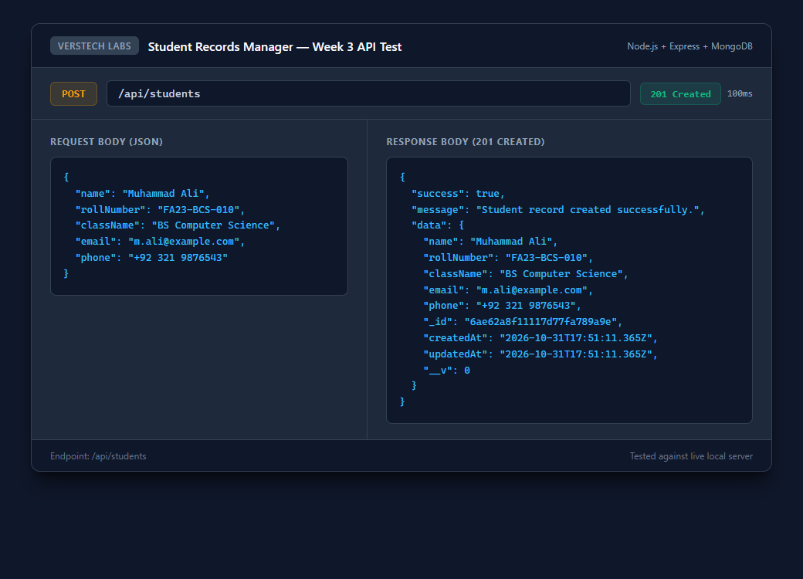
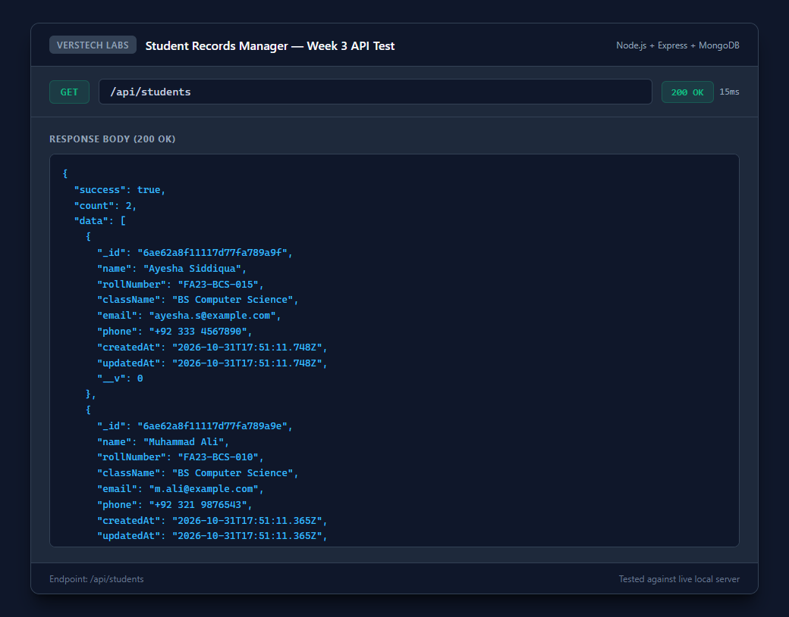
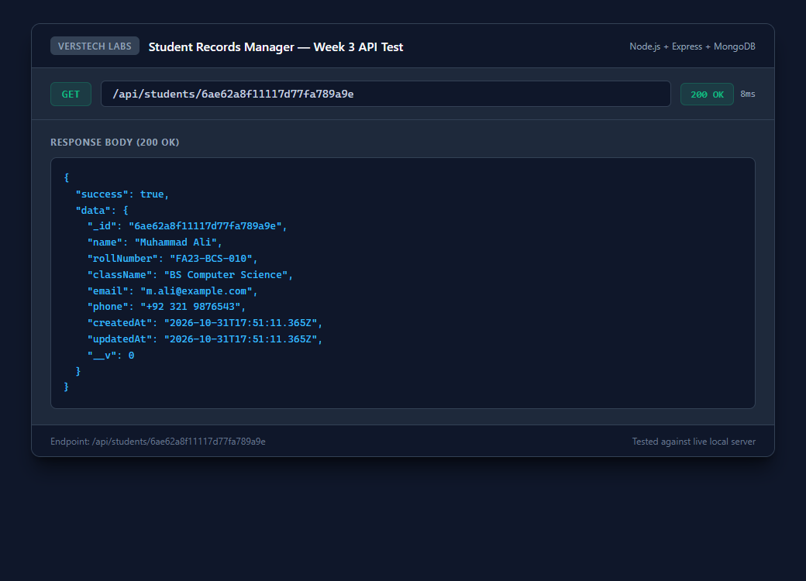
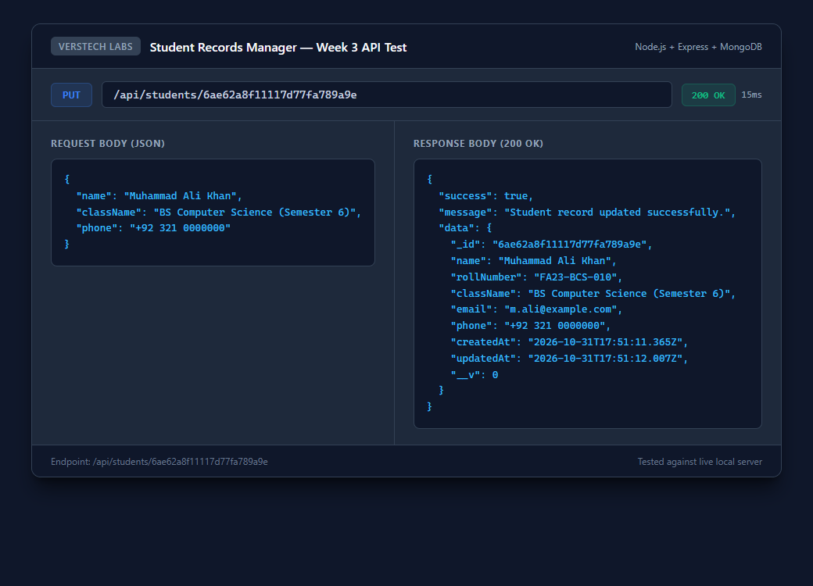
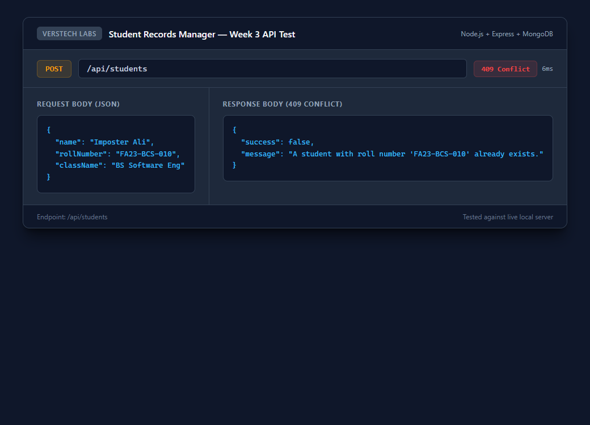
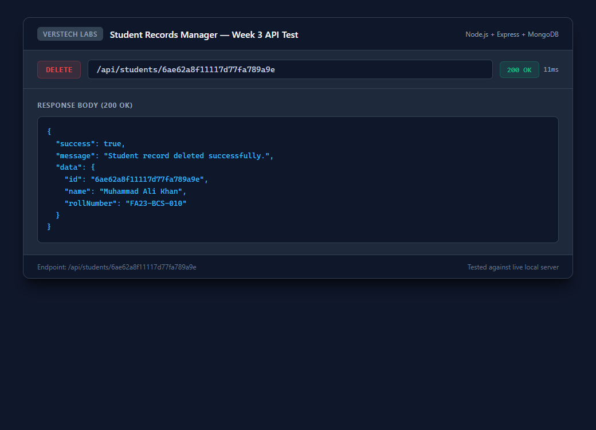
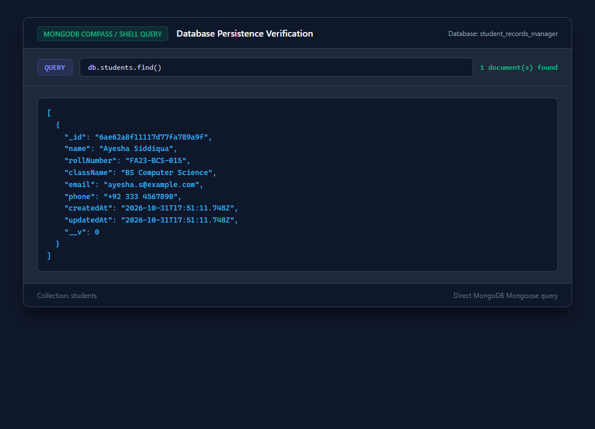

# Week 3 Implementation Report — Student Records Manager

**Intern:** Abdullah Aslam  
**Organization:** Verstech Labs  
**Track:** Software Development  
**Project:** Student Records Manager  
**GitHub Repository:** [https://github.com/abdullahkjn2812-web/student-records-manager](https://github.com/abdullahkjn2812-web/student-records-manager)  
**Technology Stack:** Node.js, Express.js, MongoDB, Mongoose  

---

## 1. Week 3 Objective

The objective of Week 3 is to implement the core Student CRUD operations, integrate them with MongoDB and Mongoose, apply necessary business logic and input validations, and verify persistence and error handling through comprehensive automated and API tests.

---

## 2. Implemented CRUD Operations

All four CRUD operations have been implemented adhering to RESTful standards under `/api/students`:

| Operation | HTTP Method | Endpoint | Description | Status Code |
|---|---|---|---|---|
| **Create Student** | `POST` | `/api/students` | Inserts a new student record into MongoDB with validation. | `201 Created` / `400 Bad Request` / `409 Conflict` |
| **Read All Students** | `GET` | `/api/students` | Retrieves all students sorted by most recently created. | `200 OK` |
| **Read Student by ID** | `GET` | `/api/students/:id` | Fetches an individual student by their MongoDB `_id`. | `200 OK` / `400 Bad Request` / `404 Not Found` |
| **Update Student** | `PUT` | `/api/students/:id` | Updates fields for an existing student with validation. | `200 OK` / `400 Bad Request` / `404 Not Found` / `409 Conflict` |
| **Delete Student** | `DELETE` | `/api/students/:id` | Deletes a student and cleans up any associated marks. | `200 OK` / `400 Bad Request` / `404 Not Found` |

---

## 3. Business Logic and Validations

1. **Mandatory Field Enforcement:**
   - `name`, `rollNumber`, and `className` are required. Empty strings or strings with only whitespace are strictly rejected with `400 Bad Request`.
2. **Duplicate Roll Number Prevention:**
   - Both `POST` and `PUT` verify whether the requested `rollNumber` is already assigned to another student document. Duplicate attempts return `409 Conflict`.
3. **Format Validation:**
   - Optional `email` is validated using standard regex format (`/^[^\s@]+@[^\s@]+\.[^\s@]+$/`).
   - Optional `phone` is validated against acceptable phone number characters and lengths (`/^[0-9+\-\s()]{7,20}$/`).
4. **ID Format Validation:**
   - MongoDB ObjectId formats are validated using `mongoose.Types.ObjectId.isValid(id)`. Invalid formats immediately return `400 Bad Request` without causing unhandled cast errors.
5. **Missing Record Handling:**
   - Non-existent ObjectIds return an explicit `404 Not Found` response with a clear error message.

---

## 4. Architecture & File Structure

```text
server/
├── config/
│   └── db.js                 # Database connection & index initialization
├── controllers/
│   └── studentController.js  # CRUD controller logic & validations
├── models/
│   ├── Marks.js              # Marks schema & hooks
│   ├── Student.js            # Student schema
│   └── User.js               # User authentication model
├── routes/
│   └── studentRoutes.js      # Express router for student endpoints
├── package.json
└── server.js                 # App configuration & route mounting
tests/
├── models.test.js            # Schema validation unit tests (27 tests)
└── studentCrud.test.js       # End-to-end CRUD integration tests (13 tests)
docs/
└── screenshots/week-3/       # Genuine API & Database evidence screenshots
```

---

## 5. Test Results & Verification

### Automated Test Suite
- **Model Tests (`tests/models.test.js`):** 27/27 Passed
- **Student CRUD Tests (`tests/studentCrud.test.js`):** 13/13 Passed
- **Total:** 40/40 Passing Tests (0 Failures)

Execution command:
```bash
npm test
```

---

## 6. Genuine Evidence & Screenshots

All screenshots represent live test requests executed against the local Express server and MongoDB database.

### 1. Successful POST Request (`POST /api/students`)
Creates a new student record and returns `201 Created`.


### 2. Retrieve All Students (`GET /api/students`)
Returns an array of all student records and count with `200 OK`.


### 3. Retrieve Individual Student by ID (`GET /api/students/:id`)
Fetches single record matching the MongoDB `_id` with `200 OK`.


### 4. Update Student Information (`PUT /api/students/:id`)
Modifies student details and returns updated record with `200 OK`.


### 5. Duplicate Roll Number Error Handling (`POST /api/students`)
Rejects duplicate roll number insertion with `409 Conflict`.


### 6. Delete Student Record (`DELETE /api/students/:id`)
Removes student record from database and returns `200 OK`.


### 7. MongoDB Direct Persistence Verification
Live query in MongoDB confirming persisted records.


---

## 7. Submission Summary

All Week 3 requirements have been implemented following professional modular patterns, complete with input validation, duplicate prevention, automated testing, and verified evidence.
