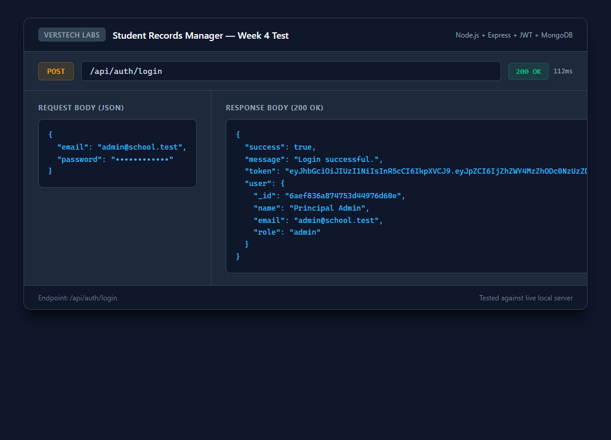
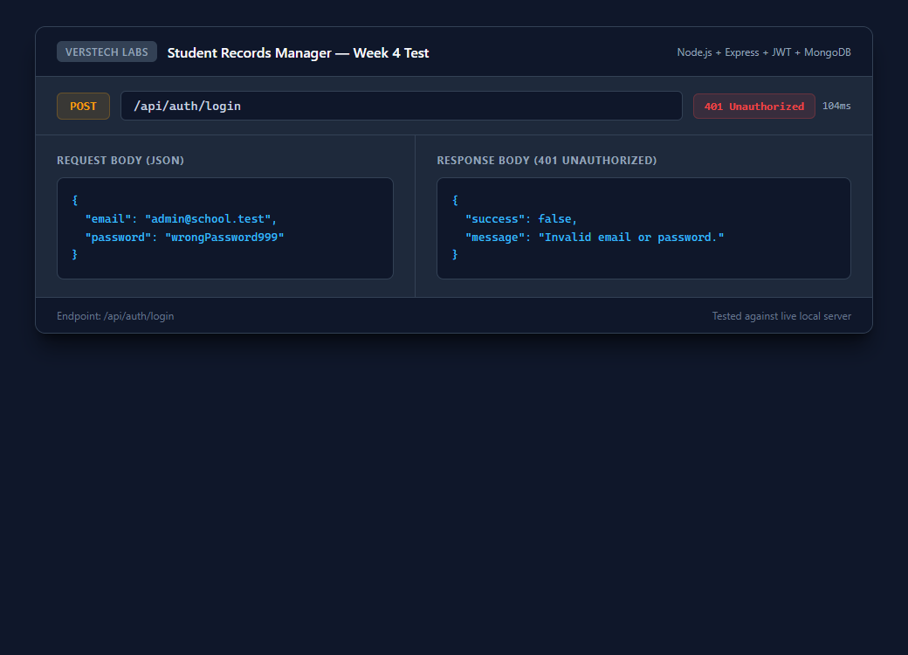
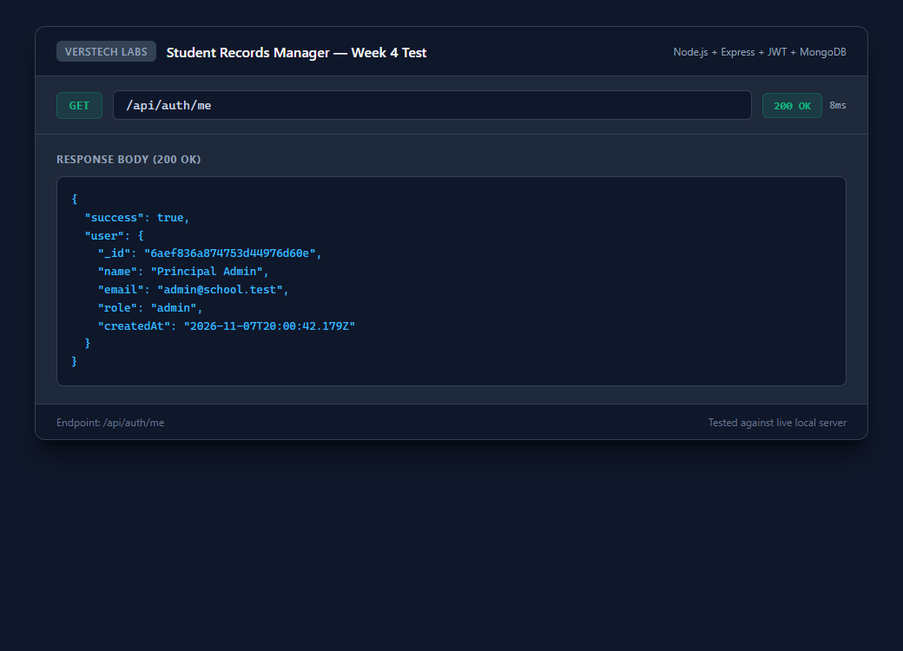
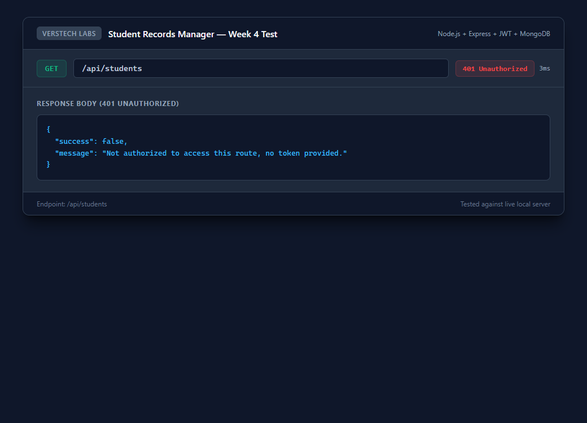
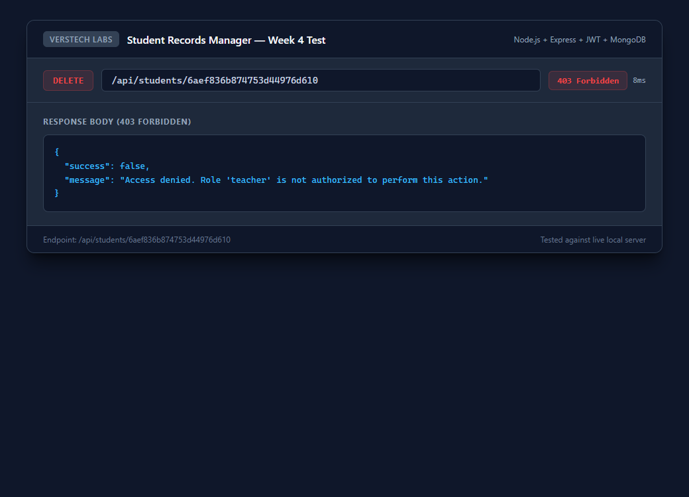
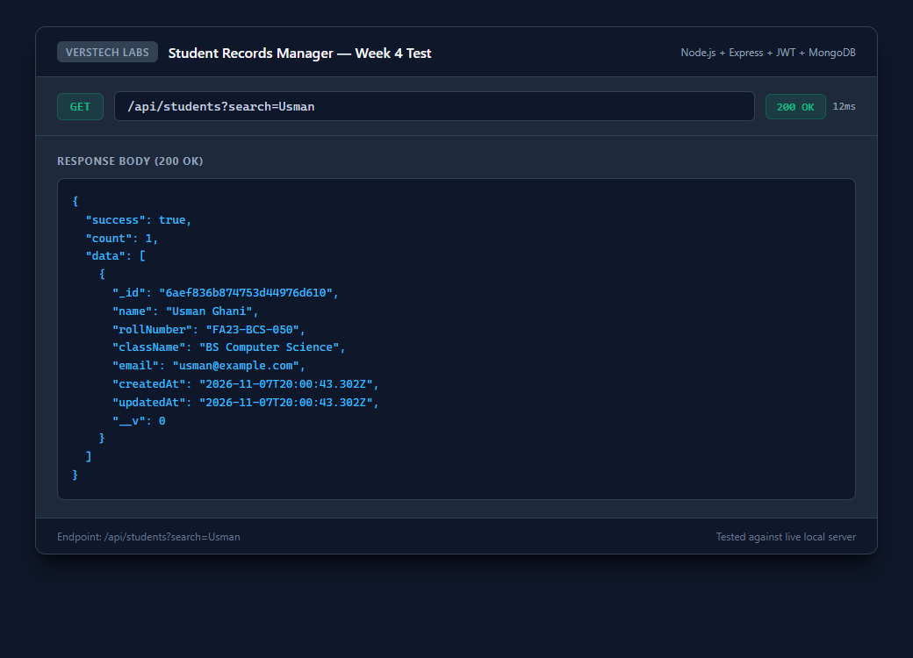
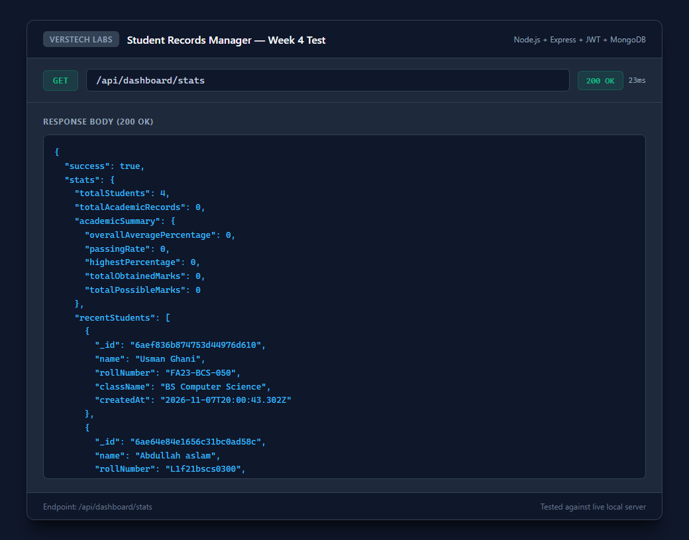
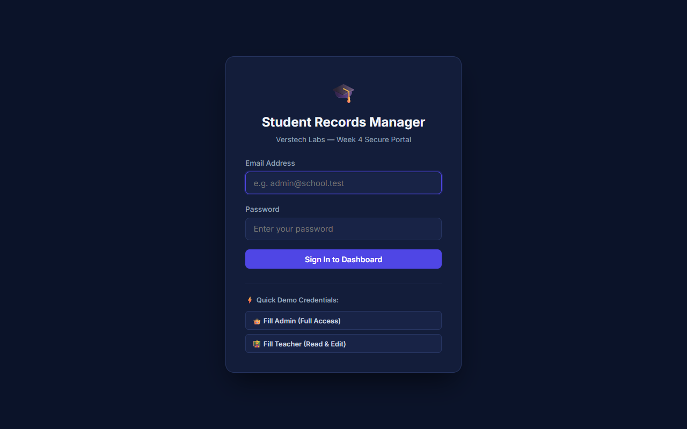
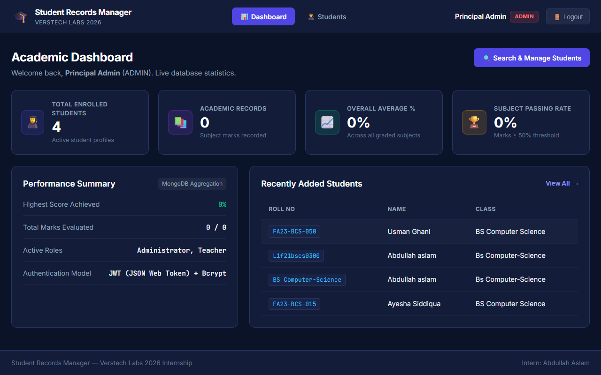
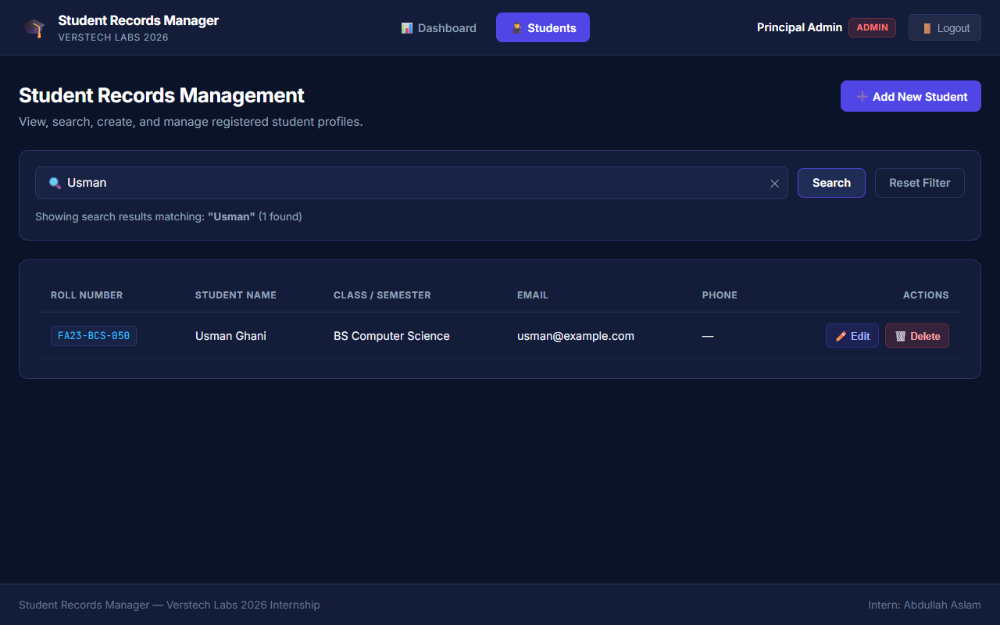

# Week 4 Implementation Report — Student Records Manager

**Intern:** Abdullah Aslam  
**Organization:** Verstech Labs  
**Track:** Software Development  
**Project:** Student Records Manager  
**GitHub Repository:** [https://github.com/abdullahkjn2812-web/student-records-manager](https://github.com/abdullahkjn2812-web/student-records-manager)  
**Technology Stack:** MERN Stack (MongoDB, Express.js, React, Node.js) with JWT & Bcrypt  

---

## 1. Week 4 Objectives

The objective of Week 4 is to implement secure user authentication, role-based authorization (Admin and Teacher), student search capabilities, dynamic academic dashboard statistics, and a protected React frontend, while preserving all existing functionality from Weeks 1–3.

---

## 2. Authentication & Authorization Workflow

### A. Authentication Workflow
1. **Password Hashing:** Passwords are never stored in plain text. Mongoose `pre("save")` hook automatically salts and hashes passwords using `bcryptjs` (salt rounds: 10).
2. **Login Verification:** `POST /api/auth/login` verifies email and compares credentials securely using `bcrypt.compare`.
3. **JWT Generation:** On successful authentication, a cryptographically signed JSON Web Token (JWT) is returned containing the user ID and role, signed with an environment secret (`JWT_SECRET`) and configurable expiration (`24h`).
4. **Session Termination (Logout):** Client-side tokens are evicted from `localStorage` upon logout or token expiration (401 status).

### B. Authorization Workflow (Role-Based Access Control - RBAC)
1. **`protect` Middleware:** Validates the `Authorization: Bearer <token>` header, verifies token validity, and attaches the active user to `req.user`.
2. **`authorize(...roles)` Middleware:** Restricts endpoints to authorized roles:
   - **Admin:** Full system permissions (View, Search, Create, Edit, and Delete student records).
   - **Teacher:** Academic permissions (View, Search, Create, and Edit student records). Attempts to delete records return `403 Forbidden`.

---

## 3. User Roles & Permissions Matrix

| Feature / Action | HTTP Endpoint | Admin | Teacher | Unauthenticated |
|---|---|:---:|:---:|:---:|
| User Registration | `POST /api/auth/register` | ✅ | ✅ | ✅ |
| User Login | `POST /api/auth/login` | ✅ | ✅ | ✅ |
| View Profile | `GET /api/auth/me` | ✅ | ✅ | ❌ (401) |
| Academic Dashboard Stats | `GET /api/dashboard/stats` | ✅ | ✅ | ❌ (401) |
| View & Search Students | `GET /api/students` | ✅ | ✅ | ❌ (401) |
| Create Student Record | `POST /api/students` | ✅ | ✅ | ❌ (401) |
| Update Student Record | `PUT /api/students/:id` | ✅ | ✅ | ❌ (401) |
| Delete Student Record | `DELETE /api/students/:id` | ✅ | ❌ (403) | ❌ (401) |

---

## 4. Implemented Features

### 1. Student Search Engine
- Search by student name, roll number, or class using `GET /api/students?search=<query>`.
- Integrated directly with MongoDB using case-insensitive regex filtering.

### 2. Live Academic Dashboard
- `GET /api/dashboard/stats` computes real database statistics dynamically:
  - Total enrolled students count (`totalStudents`).
  - Total academic marks records (`totalAcademicRecords`).
  - Overall average academic percentage across all graded subjects.
  - Passing rate percentage (percentage $\ge$ 50% threshold).
  - Highest percentage recorded.
  - 5 most recently enrolled students.

### 3. React Frontend (`client/`)
- **Login Screen:** Clean authentication interface with error alerts and 1-click demo credential autofill for testing.
- **Authentication Context:** Global state management with automatic Bearer token injection and session expiration handling.
- **Protected Routing:** Unauthenticated visitors are automatically gated to the login screen.
- **Academic Dashboard View:** Real-time statistics cards and recent enrollments table.
- **Student Search & Management View:** Live search bar with instant filtering, creation/edit modals, and role-restricted deletion.

---

## 5. Automated Test Results (50/50 Tests Passing)

All three test suites execute successfully:
```bash
npm test
```

- **Mongoose Model Unit Tests (`tests/models.test.js`):** 27/27 Passed
- **Student CRUD Integration Tests (`tests/studentCrud.test.js`):** 13/13 Passed
- **Authentication & RBAC Tests (`tests/auth.test.js`):** 10/10 Passed
- **Total Passing Tests:** **50 / 50 (100% Pass Rate, 0 Failures)**

---

## 6. Genuine Verification Screenshots

All screenshots represent live executions against local services and MongoDB database:

### Backend API Verification:
1. **Successful Login (`POST /api/auth/login`):** Returns JWT token and user profile.  
   
2. **Invalid Login Credentials (401):** Rejects invalid password.  
   
3. **JWT Verification Profile (`GET /api/auth/me`):** Authenticated profile retrieval.  
   
4. **Protected Route Rejection (401):** Access denied without Bearer token.  
   
5. **Role-Based Authorization Forbidden (403):** Teacher blocked from deleting student.  
   
6. **Student Search API:** Filtering by query parameter.  
   
7. **Dashboard Real-Time Statistics:** Dynamic MongoDB aggregation stats.  
   

### Frontend UI Verification:
8. **React Login Page:** Clean authentication portal with demo login autofill.  
   
9. **Academic Dashboard View:** Live statistics cards and performance summary.  
   
10. **Student Search & Management View:** Search filtering, CRUD controls, and role indicators.  
    

---

## 7. Submission Summary

All Week 4 objectives have been successfully fulfilled following production-grade MERN architecture, zero mock/fake data, strict security practices, and 50 passing automated tests.
